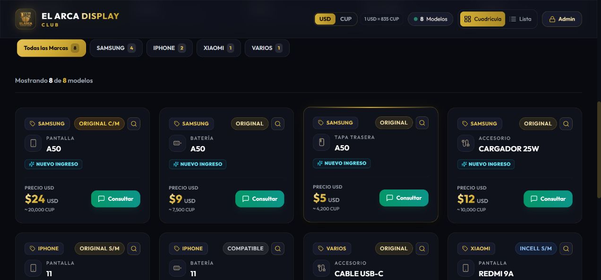
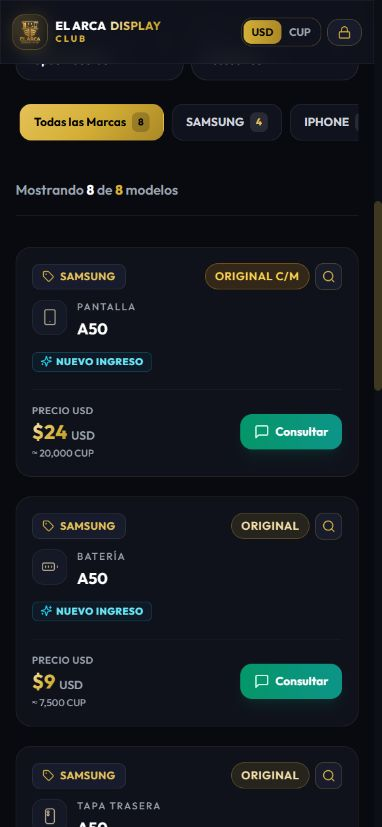
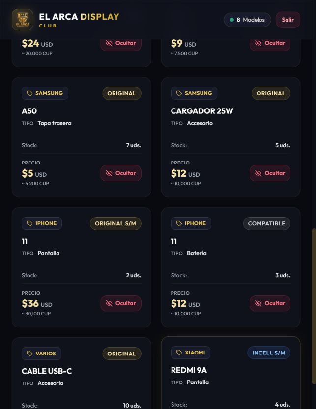
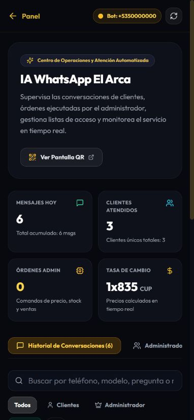

# Revisión y mejora del proyecto · 27 de octubre de 2026

Esta entrega prepara El Arca para vender pantallas, baterías, tapas traseras y accesorios con el mismo diseño oscuro y dorado. También corrige problemas de inventario, importación, presentación y contexto de la IA de clientes.

## Última revisión: eliminación definitiva e identidad de productos

### Eliminar un producto con historial

- Inventario permite **eliminar realmente el producto**, aunque tenga ventas, entradas o mermas. Requiere confirmar «Sí, Eliminar»; la API también exige una confirmación booleana explícita. El diálogo identifica categoría, modelo, calidad y unidades afectadas.
- Se elimina el documento del catálogo y del inventario. **Las ventas, devoluciones y movimientos anteriores se conservan** con sus datos originales. Si queda stock, se registra su salida a cero. Todo se ejecuta en una transacción: si falla el registro, se revierte el borrado.
- Una devolución de un producto eliminado no lo recrea: registra las unidades **fuera de inventario**. Si se devuelve como merma, conserva ese destino. Los comprobantes y el historial distinguen ambos casos de una devolución a stock.
- La anulación de una venta por la IA administrativa también admite productos eliminados sin inventar existencias. No se vuelve a cobrar ni a registrar la misma devolución al repetir una confirmación.
- El borrado no se puede deshacer desde la aplicación. Ocultar sigue disponible cuando solo se quiere dejar de publicar un producto. No se ha eliminado ningún producto real del negocio durante las pruebas.

### Diseño de las tarjetas

- Un único pictograma por identidad: pantalla, batería, tapa con cámaras o cable. Trazo fino en un pequeño recuadro neutro, con un acento champán suave; sin emojis ni iconos duplicados.
- Categoría discreta sobre el modelo, junto al icono. Marca y calidad arriba; novedades y estados debajo. La identificación no reutiliza la píldora dorada de marca o calidad.
- Componente compartido en catálogo (cuadrícula y lista), administración, inventario, POS, carrito, ocultos, duplicados e historial/devoluciones. Los selectores de etiquetas emplean la versión compacta del mismo juego de iconos; las etiquetas físicas conservan su formato de impresión.
- Se mantienen los fondos, bordes, colores principales y acciones existentes. Los nombres largos pueden partirse sin ensanchar la tarjeta.

### Verificación de esta revisión

- **46 pruebas unitarias correctas**, comprobación de tipos y compilación de producción correctas.
- Integración en una base temporal: borrar con historial, rechazar confirmaciones inválidas, no vender un producto eliminado, conservar ventas y categoría, devolver sin recrear stock, devolver a merma, anular de forma idempotente y revertir el borrado si falla el movimiento de salida.
- Revisión visual con productos ficticios de las cuatro categorías. Un solo SVG de identificación por producto. Inventario y confirmación revisados a 390 y 320 px sin desbordamiento horizontal; confirmación cancelada en la prueba visual.
- El usuario confirmó que el ajuste anterior del buscador **ya no produce zoom en Chrome de iPhone**. Se conserva esa corrección.

Las secciones siguientes documentan también las etapas anteriores; esta revisión sustituye el bloqueo antiguo del borrado con historial y las versiones anteriores de la identidad visual.

## Revisión de consistencia: tarjetas, administración y WhatsApp

- **Tarjetas (etapa anterior):** se centralizó la identidad en `ProductIdentity`. La última revisión, descrita arriba, recupera un único icono de categoría y mejora la jerarquía del modelo.
- **Marcas:** administración, POS e inventario tenían copias independientes del filtro con `scale-105`. Ahora utilizan `BrandFilter`, como el catálogo público, conservando completos los bordes del primer botón.
- **WhatsApp:** cabecera compacta en móvil, acciones que se distribuyen en varias filas, formularios apilados y contenedores con ancho limitado. La tabla se desplaza dentro de su propia región; no ensancha la página. El skeleton se adapta al mismo ancho y el detalle admite textos largos sin desbordar.
- **Verificación:** compilación de producción y 45 pruebas existentes correctas. Revisión de administración e historial a 320, 390 y 651 px; ancho del documento igual al de la ventana. Administradores, bloqueados y detalle de conversación también encajan a 320 px. Datos de demostración en una base temporal, sin escribir a clientes ni modificar el inventario del negocio. Estas medidas de navegador no sustituyen una prueba física del teclado de iPhone.

Administración con datos de demostración:

WhatsApp con registros de demostración:

## Ajustes visuales posteriores: buscador, categorías y marcas

**Segunda revisión del zoom, Chrome de iPhone:** el usuario confirmó que el primer ajuste no resolvía su caso. Se verificó que producción entregaba la regla de 16 px. El catálogo ahora declara 18 px directamente y tiene una regla específica sin media queries, sin el anterior `text-sm` y sin animaciones de métricas al enfocar. Se conserva el viewport ampliable. La validación en un iPhone físico sigue pendiente: una prueba con ventana móvil de Chrome de escritorio no reproduce el teclado de iOS ni basta para dar el fallo por resuelto.

- Los campos de texto en móvil utilizan 16 px para evitar el zoom de enfoque de iPhone. Se conserva el zoom manual: no se añadieron restricciones al viewport.
- La categoría de producto deja de ser una píldora amarilla. Ahora es una línea neutra con icono de acento frío y texto legible, sin fondo ni borde. En la tarjeta pública se elimina el icono de teléfono duplicado junto al modelo.
- «Todas las marcas» y las marcas seleccionadas ya no se agrandan dentro del contenedor. Tienen separación lateral, tamaño estable y desplazamiento horizontal sin la barra dorada.
- Verificado en navegador a 390 px: fuente del buscador enfocado de 16 px, botón completo dentro del contenedor, ausencia de desbordamiento horizontal y `viewport` sin límites de zoom. Compilación de producción correcta. No se ha probado el teclado en un iPhone físico.

## Plan ejecutado por fases

1. **Revisar la situación actual:** rutas de catálogo, inventario, ventas, comprobantes, herramientas de IA, conversación y transporte de WhatsApp; preservar las correcciones anteriores de cifrado, audio y permisos.
2. **Construir la base multicategoría:** tipos compartidos, validación, compatibilidad con documentos antiguos, búsquedas y separación de duplicados.
3. **Organizar la experiencia:** selector compartido, marcas y calidades coherentes, formularios según categoría, carrito e historial identificables y ajustes para móvil.
4. **Mejorar la conversación del cliente:** contexto más preciso, aclaraciones concretas y respuestas breves sin insistencia comercial ni de ubicación.
5. **Comprobar y documentar:** pruebas automatizadas, transacciones en bases desechables, revisión en navegador y compilación de producción.

## Qué cambió y por qué

| Área                   | Problema encontrado                                                                           | Solución                                                                                                                   |
| ---------------------- | --------------------------------------------------------------------------------------------- | -------------------------------------------------------------------------------------------------------------------------- |
| Categorías             | Todo se interpretaba como pantalla                                                            | `DISPLAY`, `BATERIA`, `TAPA` y `ACCESORIO`, con nombres e iconos compartidos                                               |
| Productos antiguos     | El valor por defecto de Mongoose no completa documentos obtenidos con `lean()` o agregaciones | Normalización explícita y filtro que reconoce registros antiguos sin categoría como pantallas                              |
| Catálogo público       | Distintos repuestos del mismo modelo podían confundirse                                       | Selector de categorías y distintivo visible en cada tarjeta y fila                                                         |
| Marcas y calidades     | Los filtros podían ofrecer opciones ajenas a la categoría                                     | Se calculan a partir de sus productos; cambiar categoría reinicia los filtros dependientes                                 |
| Categorías vacías      | Podían insinuarse existencias nuevas que no se han registrado                                 | En el catálogo público aparecen desactivadas y con «Sin existencias»                                                       |
| Inventario             | Las altas y ediciones asumían calidad de pantalla                                             | Categoría explícita y calidades apropiadas; se mantiene la opción personalizada                                            |
| Stock cero             | Algunos formularios o rutas convertían `0` en `1`                                             | Se conserva cero; no se fabrican unidades                                                                                  |
| Cantidades             | Algunas entradas fraccionarias o negativas se redondeaban o corregían silenciosamente         | Validación de enteros y números finitos, con errores visibles                                                              |
| Importación Excel      | Sincronizar borraba todo el catálogo antes de reinsertarlo                                    | Actualización y alta por ID o identidad; se conservan productos ausentes, referencias y visibilidad                        |
| Identidad en Excel     | IDs basados en número de fila podían cambiar al reordenar el archivo                          | Exportación con columna `ID`; IDs nuevos estables y búsqueda por categoría/marca/modelo/calidad                            |
| Importaciones ambiguas | Filas repetidas o identidades duplicadas podían sobrescribir productos                        | Rechazo del archivo ambiguo; se solicita ID exportado cuando hace falta                                                    |
| Stock omitido en Excel | Una celda vacía podía borrar cantidades existentes                                            | Conserva stock previo; para un producto nuevo sin cantidad usa 1. Un cero explícito sigue siendo cero                      |
| Historial de stock     | Editar cantidades o importar no siempre dejaba un movimiento                                  | Se registra antes, después, diferencia y motivo dentro de la misma transacción                                             |
| Borrado definitivo     | Podía dejar ventas o movimientos sin referencia                                               | Confirmación explícita, cierre del stock y conservación del historial; devoluciones posteriores fuera del inventario       |
| Restauración inicial   | Podía reiniciar un catálogo con actividad comercial                                           | Se bloquea si existen ventas o movimientos; la alternativa es importar conservando referencias                             |
| Confirmación del panel | Se mostraba éxito local aunque la API rechazara guardar                                       | Las acciones actualizan la pantalla después de confirmar éxito en el servidor                                              |
| Duplicados y fusiones  | Baterías y pantallas del mismo modelo podían parecer equivalentes                             | Comparación y fusión separadas por categoría; selección ambigua pide identificación exacta                                 |
| IA administrativa      | La limpieza de modelos de pantalla podía alterar otros repuestos                              | La limpieza específica de displays solo se aplica a pantallas; se mantienen las confirmaciones de operaciones              |
| Ventas                 | El ticket no distinguía tipos de repuesto con el mismo modelo                                 | Categoría capturada desde el producto real, conservada en venta y devolución, visible en carrito, historial y comprobantes |
| Comprobantes HTML      | Textos de cliente, notas o productos se interpolaban sin escapar                              | Escape de contenido antes de generar HTML imprimible                                                                       |
| Contacto en tickets    | Había un teléfono antiguo escrito directamente en el código                                   | Se utiliza el contacto configurado del negocio; se omite si no está disponible                                             |
| Caché del catálogo     | Un fallo de API podía presentar el catálogo inicial como existencias actuales                 | Solo se usa caché guardada con aviso de datos no verificados y posibilidad de reintentar                                   |
| Móvil                  | Cabecera y etiquetas podían quedar cortadas                                                   | Navegación compacta, etiquetas que se distribuyen en filas y formularios con desplazamiento                                |
| Carga                  | El acceso podía mostrar fugazmente «Acceso denegado» antes de validar sesión                  | Skeleton mientras se comprueba la sesión en panel, POS, inventario e historial                                             |

## La nueva experiencia visual

- **Público:** búsqueda → categoría → marca/calidad → resultados. En móvil, «Todo el catálogo» ocupa una fila y las cuatro categorías forman una cuadrícula de dos columnas.
- **Administrador:** el mismo selector en el panel de catálogo, inventario y POS. No hay que aprender tres organizaciones distintas.
- **Producto:** conserva sus tarjetas y colores; añade un distintivo de categoría. Los controles se ajustan sin recortar las etiquetas.
- **Formulario:** elegir «Baterías» muestra calidades de batería; «Pantallas» conserva opciones de pantalla. Modelo, precio y stock siguen en el mismo flujo.
- **Carrito e historial:** una pantalla A50 y una batería A50 aparecen separadas, con identificación de categoría.
- **Carga:** categorías con skeleton de tamaño equivalente y comprobación de sesión antes de mostrar el panel.

No se añadieron productos ficticios al negocio. Las categorías nuevas se activan para clientes cuando registres productos con stock.

Vista móvil verificada con productos de ejemplo en una base temporal:

## Cambios en la IA de clientes

### Menos repetición

Los saludos y agradecimientos sencillos se responden directamente. El modelo recibe instrucciones de responder a la última pregunta en una a cuatro frases, sin repetir presentación, ubicación, horarios, garantías, instalación o pagos en cada mensaje. Esos temas se tratan cuando el cliente los solicita o son necesarios para resolver su consulta.

La identificación «Asistente automático» se añade al inicio de la conversación, sin repetirla en cada respuesta generada.

### Mejor contexto

Antes se añadían mensajes anteriores del bot a la consulta de catálogo. Eso podía arrastrar modelos que el propio asistente había mencionado. Ahora la búsqueda del cliente usa la consulta actual y referencias pertinentes de mensajes del usuario.

Ejemplos de comportamiento cubierto:

- «Samsung A50» → «¿Y con marco?» mantiene el modelo consultado.
- Cambiar a «Redmi 9A» deja de buscar Samsung A50.
- Responder «Batería» después de indicar un modelo conserva ese modelo y cambia de categoría.
- Preguntar «Busco baterías» y luego «A50» mantiene la categoría aclarada.
- Consultar un modelo con varios tipos de repuesto disponibles genera una pregunta concreta con las categorías verificadas, sin inventar las demás.
- Una consulta ambigua borra la cotización anterior para que «en pesos» no convierta otro producto por error.

Las búsquedas con identificadores numéricos exigen coincidencia de modelo, en lugar de devolver cualquier producto que comparta la marca. Esto reduce cruces entre modelos; no declara compatibilidad técnica entre variantes.

### Administración y seguridad

Se conservan las respuestas y el flujo administrativo existentes. Las herramientas siguen siendo propuestas: requieren `CONFIRMAR` escrito y se vuelven a validar antes de modificar datos. Los clientes continúan sin herramientas de escritura ni acceso a finanzas o stock exacto.

## Uso de Excel después de esta entrega

1. Exporta el catálogo desde `/admin`. Incluye `CATEGORIA` e `ID`.
2. Conserva los IDs al editar o reordenar productos.
3. Usa `DISPLAY`, `BATERIA`, `TAPA` o `ACCESORIO`; se aceptan nombres habituales como «Baterías» y «Tapas traseras».
4. Un archivo antiguo sin categoría se interpreta como pantallas. Para otras categorías, incluye la columna.
5. **Importar actualiza o añade; ya no reemplaza ni elimina todo el inventario.** Para retirar un producto, ocúltalo desde el panel.
6. Una cantidad en blanco conserva la existente; escribe `0` para dejar agotado un producto.
7. Cantidades negativas o fraccionarias se rechazan; no se redondean. Los importes admiten formatos habituales como `$12,50 USD`.
8. Si una fila es inválida, la transacción se revierte: no queda una importación parcial.

## Verificación realizada

- **45 pruebas automatizadas** de sesiones, CSRF, firmas, contratos, stock, búsqueda, categorías, Excel, contexto del cliente, formato de WhatsApp, audio y reconexión.
- **Integración con MongoDB real en bases temporales:** rollback, confirmación concurrente única, anulación, conservación de stock cero, lotes, categorías heredadas, importaciones, permisos, ventas, contexto exacto de IA, cola y recibos que no retroceden.
- **Navegador, entorno aislado:** catálogo con las cuatro categorías, filtro de baterías y marcas, móvil de 390 px, formulario con calidades de batería, alta con stock cero, carrito con pantalla y batería del mismo modelo y venta sin imprimir.
- **Dependencias:** `npm audit` sin vulnerabilidades reportadas en web y puente en esta revisión.
- **Compilación:** `npm run build` incluye validación de TypeScript y generación de rutas de producción.

Las pruebas de inventario y ventas usan bases con prefijo de verificación y limpieza limitada a esas bases. No se ejecutó una migración masiva ni una venta de prueba sobre los datos del negocio.

## Cómo revisarlo mañana

1. Abre el catálogo desde el móvil y comprueba la navegación por categorías y la búsqueda.
2. En inventario, abre «Agregar producto» y alterna categorías para revisar las calidades. Solo guarda productos reales.
3. Comprueba que un producto con stock cero aparece en inventario y no como disponible en el catálogo público.
4. En POS, revisa que el carrito distingue categoría y modelo antes de cobrar.
5. Prueba WhatsApp con saludo, consulta de producto, aclaración, cambio de modelo y agradecimiento. Observa que no vuelve a ofrecer dirección en cada turno.
6. Exporta un Excel y comprueba `CATEGORIA` e `ID` antes de preparar futuras importaciones.

## Límites y continuidad

Una batería, tapa o accesorio se ofrece únicamente si está registrado. Las calidades son descripciones comerciales, no una certificación de originalidad o compatibilidad. La IA sigue siendo generativa: estas defensas reducen respuestas inadecuadas, pero la calidad conversacional debe contrastarse con consultas reales.

La comprensión de audio, formato de negritas, cifrado, recibos y reconexión anteriores siguen cubiertos por pruebas. Esta entrega no realiza envíos nuevos a clientes. El puente continúa dependiendo de que la PC esté encendida, despierta y conectada; la web en Vercel y el bot local son procesos distintos.

## Archivos principales

- `src/lib/categories.ts`: catálogo de categorías y compatibilidad.
- `src/components/CategoryFilter.tsx`: selector, distintivos y skeleton compartidos.
- `src/lib/catalogImport.ts` y `catalogNumbers.ts`: importación segura y números de Excel.
- `src/lib/whatsapp/customer.ts` y `service.ts`: política del cliente y recuperación de contexto.
- `src/lib/ai/adminTools.ts`, `contracts.ts`, `operations.ts`: herramientas y confirmaciones con categoría.
- `src/app/api/products/route.ts`, `sales/route.ts`: persistencia, historial y ventas.
- `src/components/PrintTicket.tsx` y `src/lib/printSafety.ts`: comprobantes identificables y HTML seguro.
- `scripts/tests/multicategory.test.cjs` y `scripts/verify-bot-integration.cjs`: regresiones y flujos transaccionales.
